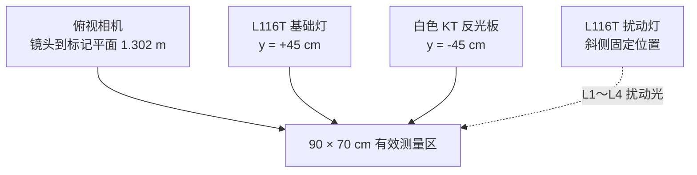
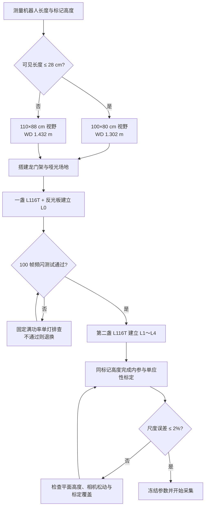

# 第二学期场地搭建与采购方案

> **状态提示（2026-10-13）**：本文保留了早期“龙门架 + Viltrox 灯”的论证过程，已不再作为当前采购和搭建依据。现行方案为“相机独立横臂三脚架 + 三只灯架 + 两盏公牛 50 W 基础灯 + 一盏公牛 100 W 强光灯”，请以[第二学期项目实施方针](./第二学期项目实施方针.md)为准。

> 本方案以海康 MV-CU013-A0UC、MVL-HF0828M-6MPE 8 mm 镜头和 21/31 cm/s 测速任务为基线，给出可直接采购、搭建和验收的低复杂度实验场地。
> 适用范围：第二学期二维运动测速与强光退化实验；资料核对至 2026-10。

## 结论摘要

推荐采用“中央俯视相机、两侧对称面板基础光、斜侧单灯强光”的三灯方案。相机在跟踪标记平面上覆盖 **100 × 80 cm**，其中有效测量区取 **90 × 70 cm**；镜头到跟踪标记平面的工作距离取 **1.302 m**，因此镜头离地高度不是固定 1.30 m，而是：

```text
镜头离地高度 = 机器人跟踪标记离地高度 + 1.302 m
```

若机器人在运动方向上的可见轮廓长度超过 28 cm，90 cm 测量区无法同时容纳 31 cm/s 下 2 s 的完整稳态窗口，应切换为 **100 × 70 cm 测量区、110 × 88 cm 视野、1.432 m 工作距离**。这项判断必须在采购型材前测量机器人实物。

最低可用照明改为两盏 **Viltrox L116T** 小型面板灯：一盏负责基础光，另一盏从斜侧制造强光扰动；基础光另一侧放一块白色 KT 板反光。两盏灯均使用 5600 K 和 12 V/2 A 适配器，不购买电池、摄影灯架、COB 灯、遮扉或 ND 滤片。灯具用带 1/4 英寸螺钉的万向夹固定在龙门架或桌边，整套新增照明控制在约 **450～600 元**。

### 方案复核后的主要修正

| 原方案中容易误解或需补强之处 | 复核结论 | 对搭建与采购的影响 |
|---|---|---|
| 相机高度约 1.30 m | 1.302 m 是镜头到跟踪标记平面的工作距离，不是镜头离地高度 | 龙门架立柱需留高度调节量；切料前先量标记高度 |
| 测量区直接取 90 cm 长 | 仅当机器人运动方向可见长度不超过 28 cm 时成立 | 机器人更长时改用 100 cm 测量区和 110 × 88 cm 视野 |
| 只要画面够亮即可 | 31 cm/s 时曝光应控制在 2.5～4 ms，验收上限 5 ms | 先靠灯距、光圈补光，再小幅增加增益 |
| 用灯具调光档位定义强光等级 | 最低预算版先测试 25%、50%、75%、100% 四档；若低档频闪明显，则让灯具保持 100% 并按四个固定距离分级 | 不购买 ND 滤片，但报告中要注明灯距也发生了变化 |
| 影视灯可直接用于高速采集 | 官方规格没有承诺本项目在 60～200 fps 下无频闪 | 选择可退换渠道，收货后先完成 100 帧测试 |

---

## 一、方案原理与决策依据（Explanation）

### 1.1 相机在系统中的位置

相机承担的是二维运动测量，而不是普通演示录像。它需要把机器人在实验平面上的像素位置转换为厘米坐标，再由时间戳计算速度。因此，场地尺寸、相机高度、标定平面和曝光时间都会直接进入最终速度误差，不能仅以“画面能拍全”为验收标准。

现有相机为 1280 × 1024 全局快门彩色相机，传感器有效尺寸约 6.144 × 4.9152 mm，镜头焦距 8 mm。参数来源见仓库内[相机规格书](MV-CU013-A0UMUC_20240410.pdf)、[镜头规格书](MVL-HF0828M-6MPE_20221022_12790_202609030805.pdf)和[参数汇总](相机与镜头参数汇总.md)。海康官网列出的该型号基线同样为 1280 × 1024、USB 3.0、201.4 fps；实际帧率仍以本机性能测试结果为准。[HIKROBOT 产品列表](https://www.hikrobotics.com/en/machinevision/visionproduct/?id=168&pageNumber=1&pageSize=50&showEol=false&typeId=78)

### 1.2 视场与工作距离复算

在薄透镜近似下，视野尺寸按下式估算：

```text
水平视野宽度 = 传感器宽度 × 工作距离 ÷ 焦距
垂直视野高度 = 传感器高度 × 工作距离 ÷ 焦距
```

由 6.144 mm × 4.9152 mm 传感器和 8 mm 镜头可得：

- 水平视场角约 42.01°。
- 垂直视场角约 34.15°。
- 100 cm 水平视野对应 130.2 cm 工作距离。
- 由于传感器比例为 5:4，100 cm 水平视野同时对应约 80 cm 垂直视野。
- 1280 px 覆盖 100 cm，横纵两个方向均约为 12.8 px/cm。

候选尺寸的结果如下，表中工作距离均指镜头到跟踪标记平面：

| 水平视野 | 垂直视野 | 工作距离 | 分辨率 | 用途 |
|---:|---:|---:|---:|---|
| 90 cm | 72 cm | 1.172 m | 14.22 px/cm | 留边不足，不推荐作为主方案 |
| **100 cm** | **80 cm** | **1.302 m** | **12.80 px/cm** | 推荐主方案 |
| 110 cm | 88 cm | 1.432 m | 11.64 px/cm | 机器人轮廓较长时的回退方案 |
| 120 cm | 96 cm | 1.562 m | 10.67 px/cm | 需要更大操作余量时使用 |
| 150 cm | 120 cm | 1.953 m | 8.53 px/cm | 第三学期扩展预案，不用于本学期 |

100 × 80 cm 不是最终标定区，而是相机视野。四周各扣除约 5 cm 后，有效测量区为 90 × 70 cm。这样既避免目标紧贴图像边缘，也给透视校正、灯具不均匀和安装误差留下余量。

### 1.3 为什么必须按标记平面确定高度

如果单应性在地面标定，而算法跟踪的是机器人顶部轮廓，两个平面之间的高度差会产生尺度变化。以镜头距地 1.30 m、目标顶部高 15 cm 为例，目标顶部相对地面会放大约 `1.30 / 1.15 ≈ 1.13`，误差量级远大于本项目允许的速度误差预算。

推荐在机器人顶部设置一个固定的高对比度平面标记，并把棋盘格或四角标定点抬到同一高度完成标定。这样，像素坐标、单应性矩阵和运动轨迹处于同一物理平面，原有 `CY_OFFSET_K` 只需处理轮廓中心与标记中心的残差，而不再承担主要视差补偿。

因此，龙门架应提供约 1.35～1.65 m 的镜头离地调节范围。最终高度按实测标记高度计算，而不是直接把镜头固定在离地 1.30 m。

### 1.4 测量区长度的适用条件

31 cm/s 下，2 s 稳态窗口需要 62 cm 行程。若希望目标完整入镜，90 cm 测量区剩余的进出缓冲总长为 28 cm。因此，90 cm 主方案的适用条件是：

```text
机器人沿运动方向的有效可见长度 ≤ 28 cm
```

若实物长度超过 28 cm，优先切换至 110 × 88 cm 视野和 100 × 70 cm 测量区，而不是压缩稳态时间。后者会降低统计稳定性，也不利于与 21 cm/s 数据采用统一协议。

### 1.5 曝光时间与运动模糊

主方案下，31 cm/s 对应约 `31 × 12.8 = 396.8 px/s`。不同曝光时间产生的理论运动模糊如下：

| 曝光时间 | 理论运动模糊 |
|---:|---:|
| 2.0 ms | 0.79 px |
| 2.5 ms | 0.99 px |
| 3.0 ms | 1.19 px |
| 4.0 ms | 1.59 px |
| 5.0 ms | 1.98 px |
| 8.0 ms | 3.17 px |

最低预算照明下，初始曝光从 **4 ms** 开始，光圈优先使用 F2.8～F4，增益从 0 dB 起步。曝光上限仍为 5 ms，亮度不足时先缩短灯距，再小幅增加增益。

### 1.6 为什么最低预算版采用“两灯一反光板”

基础测量需要的是大面积、对称、低阴影照明；强光实验需要的是方向明确、能产生热点和阴影的扰动光。把这两个目标交给不同灯具，实验变量更容易解释。

- 一盏面板灯和白色 KT 板负责 L0 基线。反光板只能减弱阴影，均匀性不如双灯方案。
- 第二盏同型号面板灯负责 L1～L4，不改变基础灯的位置和输出。
- 环形灯在 1 m 级视野下需要很大的发光直径，成本高且仍可能产生同轴高光，因此不采用。
- 穹顶灯和同轴光适合较小、反光目标，通常需要靠近目标，会侵占机器人运动空间，因此不采用。
- 普通教室顶灯和窗外自然光不可控，可能带来频闪和时段差异，只能作为需要隔离的环境光。

机器视觉厂商资料指出，方向性明场光容易在反光表面形成热点，而大面积漫射光能从多个方向入射，改善混合反射表面的均匀性。[Basler 机器视觉照明说明](https://www.baslerweb.com/en/learning/illumination/)、[Advanced Illumination 照明指南](https://advancedillumination.com/a-practical-guide-to-machine-vision-lighting/)

### 1.7 方案边界与已知代价

本方案服务于课程项目，不复刻航天器的真实太阳辐照度。L0～L4 代表相机所见图像的可重复退化等级，不应声称等价于某个真实太空照度。使用影视常亮灯而非专用机器视觉灯，可以明显降低成本并扩大照射面积，但灯具在 60～200 fps 下是否无频闪不能只看商品宣传，必须在退货期内完成 100 帧空场测试。

如果 L116T 在低输出档位出现周期性亮度波动，先测试 100% 输出。满功率合格时，可以把扰动灯放在四个预先标记的距离上建立 L1～L4；这种做法同时改变强度和照射范围，实验报告必须如实记录。若满功率仍有明显频闪，则在退货期内退换。

---

## 二、参数、布局与采购清单（Reference）

### 2.1 场地最终尺寸

主方案采用以下尺寸，尺寸关系按运动方向从前到后排列：

| 区域 | 推荐尺寸 | 说明 |
|---|---:|---|
| 助跑段 | 40 cm | 机器人在进入视野前达到目标速度 |
| 有效测量区 | 90 × 70 cm | 位于相机视野中央 |
| 离场段 | 30 cm | 避免到达点进入测量区 |
| 直线运动总长 | 160 cm | 40 + 90 + 30 cm |
| 相机视野 | 100 × 80 cm | 位于跟踪标记平面 |
| 哑光铺面建议尺寸 | 160 × 100 cm | 覆盖轨道与相机视野边缘 |
| 龙门架净跨 | ≥120 cm | 避开 100 cm 铺面和灯具 |
| 镜头离地高度 | 标记高度 + 130.2 cm | 预留现场微调 |

若机器人有效可见长度大于 28 cm，则把测量区改为 100 × 70 cm、视野改为 110 × 88 cm、工作距离改为 143.2 cm，直线总长相应增加至约 170 cm。

### 2.2 坐标化布置

以下坐标以有效测量区中心为原点，`x` 沿 90 cm 运动方向，`y` 沿 70 cm 横向，`z` 为相对跟踪标记平面的高度：

| 设备 | 建议坐标 | 朝向/设置 |
|---|---|---|
| 相机 | `(0, 0, 130 cm)` | 光轴垂直向下，传感器长边沿 x 方向 |
| 基础灯 | `(0, +45 cm, 45～60 cm)` | L116T，指向原点，5600 K、100% |
| 白色反光板 | `(0, -45 cm, 20～50 cm)` | 600 × 900 mm 白色 KT 板，朝向测量区 |
| 扰动灯 | `(-45 cm, +35 cm, 35～50 cm)` | L116T，斜向原点，5600 K，输出按 L1～L4 设置 |

现场空间不足时可以沿同一射线平移灯具，但一旦确定位置，L0～L4 全部实验期间不再改变。布局关系如下：



### 2.3 光照等级定义

所有等级均关闭自动曝光、自动增益和自动白平衡。基础灯固定在 5600 K、100% 输出，扰动灯位置固定。先用扰动灯的功率档位分级：

| 等级 | 基础灯 | 强光灯输出 | 首批滤片 | 名义相对强光 |
|---|---|---|---|---:|
| L0 | 开 | 关 | 无 | 0 |
| L1 | 开 | 25% | 无 | 1/4 |
| L2 | 开 | 50% | 无 | 1/2 |
| L3 | 开 | 75% | 无 | 3/4 |
| L4 | 开 | 100% | 无 | 1 |

上述比例只是灯具设置值，不能直接当作实际照度比例。每一级仍需记录整幅平均灰度、目标区域灰度中位数和过曝像素比例。若 25%～75% 档位出现频闪，可让扰动灯保持 100%，改用四个固定距离分级；相应灯距必须写入实验记录。

滤片必须安装在反光罩或遮扉外侧，不能贴在 LED 发光面上；每次实验前确认滤片没有卷曲、烧蚀或松脱。最终等级仍以整幅平均灰度、目标区域灰度中位数和过曝像素比例记录，不用理论档位代替实测代理量。

### 2.4 推荐购物清单

下表只列没有它就无法按本方案搭建的物品。现有相机、镜头、电脑、卷尺和常用工具不重复采购；USB 线和型材若实验室已有，也从订单中删除。

| 类别 | 必买型号/规格 | 数量 | 下单要求 |
|---|---|---:|---|
| 基础灯与扰动灯 | **Viltrox L116T** | 2 | 15 W、3300～5600 K、CRI≥95；两盏同型号。购买含 12 V/2 A 适配器的套装，不买电池。[官方规格](https://viltrox.com/products/viltrox-l116t-ra-cri95-super-slim-led-light-panel-3300k-5600k-led-video-light-panel-lcd-display-screen-color-temperature-and-brightness-can-be-adjusted-with-np-f550-lithium-battery) |
| 灯具固定 | 1/4 英寸螺钉万向夹／魔术臂，夹口≥45 mm | 2 | 一只夹龙门架，一只夹桌边；额定承重至少 1 kg |
| 反光板 | 600 × 900 × 5 mm 白色 KT 板 | 1 | 用于基础灯对侧补光，不需购买摄影反光板 |
| 哑光铺面 | 深灰哑光 PVC，1600 × 1000 mm、厚约 2 mm | 1 | 整张无拼缝，不选木纹、亮面和高反差花纹 |
| 标定板 | A3 哑光打印棋盘格，9 × 6 内角点、30 mm 方格，裱在 5 mm KT 板上 | 1 | 按 100% 比例打印，禁止“适合页面”；打印后实测方格边长 |
| 相机龙门架 | 欧标 4040 槽 8：1800 mm ×2、1400 mm ×1；欧标 4080 槽 8：800 mm ×2 | 1 套 | 若实验室已有横梁或桁架则不买 |
| 龙门架连接 | 4040 重型角码 ×8、M8 T 型螺母/螺栓 ×24、M12 调平脚 ×4 | 1 套 | 与型材槽型一致 |
| 相机转接板 | **CAM-PLATE-01**：80 × 80 × 3 mm 铝板 | 1 | 按相机实物孔位开孔，并开两个连接 T 型螺母的 M8 长圆孔 |
| 相机数据线 | **HIKROBOT MV-ACU3-MBMs-AM-ST-3m** | 0～1 | 原装线或现有锁紧式 USB3 线可用时不买；缺线时必须购买。[海康产品列表](https://www.hikrobotics.com/en/machinevision/visionproduct/?id=80&typeId=78) |
| 固定耗材 | 哑光布基胶带、扎带 | 各1 | 固定铺面、线缆和位置标记 |

L116T 的官方规格为 15 W、CRI≥95，0.5 m 最大照度约 810 lux。两灯方案的照度不高，因此灯到测量区中心的距离控制在约 0.5～0.7 m，光圈优先开到 F2.8，曝光允许增加到不超过 5 ms。5 ms 下的理论运动模糊约为 1.98 px。

### 2.5 照明采购预算控制

以下金额是下单控制价，不是固定市场报价。超过控制价时先向第二家渠道询价。

| 项目 | 数量 | 单件控制价 | 小计上限 |
|---|---:|---:|---:|
| L116T，含 12 V/2 A 适配器 | 2 | 220 元 | 440 元 |
| 万向夹／魔术臂 | 2 | 50 元 | 100 元 |
| 白色 KT 反光板 | 1 | 30 元 | 30 元 |
| **首批照明合计** |  |  | **控制在 570 元以内** |

推荐成交目标为 **450～570 元**。价格会随平台和促销变化，采购时应记录适配器是否包含、退换条件和到货期。灯具到货后先测试频闪和实际亮度，再决定是否需要增加灯具；本学期不预购第三盏灯。

### 2.6 标定板尺寸要求

标定板没有必须做成 300 × 210 mm 或必须使用铝塑板的硬性要求。真正不能改错的是以下四项：

1. 软件配置的内角点数量必须和图案一致。本方案使用 9 × 6 内角点，因此纸面图案是 10 × 7 个方格。
2. 所有方格边长必须相同，软件中的 `square_size` 必须填写打印后的实测边长。
3. 图案必须平整、哑光、黑白边界清楚，拍摄期间不能弯曲。
4. 内参照片要覆盖画面中心、边缘和四角，并包含多个倾角，不能只在中心拍一张正对图。

30 mm 方格在推荐视野下约为 38.4 px，识别余量较好，因此仍推荐 A3 打印的 300 × 210 mm 图案。它可以直接裱在 5 mm KT 板上，不需要定制金属板。若只能使用 A4，可改为 20 mm 方格，图案为 200 × 140 mm，对应约 25.6 px/格；标定时需要多拍边缘位置。打印时必须关闭“适合页面”，并用钢尺连续测量 5 格或 10 格，以平均值填写 `square_size`。

### 2.7 不建议首批采购的物品

以下物品暂不进入首批订单：

| 物品 | 暂缓原因 |
|---|---|
| 大型工业环形灯 | 覆盖 1 m 视野成本高，且同轴方向可能强化表面热点 |
| 穹顶光源 | 需要靠近目标，占用运动空间，尺寸也不经济 |
| ND 镜头滤镜 | 会同时衰减基础光和强光，不利于只控制强光变量 |
| 9～24 V 相机电源 | 相机支持 USB 供电，先完成 5 分钟取流测试再决定 |
| USB3 扩展卡 | 先使用主板原生 USB3 端口；只有性能测试证明带宽或稳定性不足时再买 |
| 照度计 | 光照等级由相机代理量定义；照度计只能作为报告旁证 |

---

## 三、首次搭建教学（Tutorial）

> 缺口：平台尚未完成一次真实搭建，当前没有经过现场验证的“零分支首次搭建教程”。完成首轮搭建并记录实际孔位、灯距、曝光和失败点后再补写本节。

---

## 四、搭建与验收操作（How-to）

### 4.1 下单前冻结两个实物尺寸

在采购型材和加工 CAM-PLATE-01 前，先完成以下测量：

1. 测量机器人沿运动方向的最大可见长度 `L_robot`。
2. 测量拟跟踪顶部标记到地面的高度 `h_marker`。
3. 若 `L_robot ≤ 28 cm`，使用 100 × 80 cm 视野主方案。
4. 若 `L_robot > 28 cm`，使用 110 × 88 cm 视野回退方案。
5. 镜头目标离地高度分别设为 `h_marker + 130.2 cm` 或 `h_marker + 143.2 cm`。

这两个尺寸未确认前，可以采购灯具和线缆，但不要切割相机立柱或加工固定孔。

### 4.2 按顺序完成场地搭建

搭建顺序如下，前一步未验收时不进入下一步：

1. 铺设 160 × 100 cm 哑光 PVC，并标出 90 × 70 cm 有效测量区。
2. 在测量区前留 40 cm 助跑段，后留 30 cm 离场段。
3. 组装 4040 龙门架，横梁净跨不小于 120 cm；两侧底座加配重。
4. 安装相机，使传感器 1280 px 长边与机器人主要运动方向一致。
5. 用卷尺初调镜头到标记平面的距离，再通过实拍边界微调视野至 100 × 80 cm。
6. 固定 USB3 线，在相机端预留松弛弯，线缆重量不得直接拉扯接口。
7. 安装一盏 L116T 作为基础灯，并在对侧放置白色 KT 反光板。
8. 安装第二盏 L116T 作为斜侧扰动灯，确认夹具和电源线不进入运动通道。
9. 封闭或遮挡窗户，关闭不参与实验的顶灯。
10. 所有位置确定后，在地面用胶带标出三只灯架脚的位置和方向。

完成上述步骤后，机械结构、视野和照明几何即被冻结。移动相机、调整镜头焦点或改变灯位后，必须重新标定。

### 4.3 相机与基础光验收

验收按以下顺序执行：

1. 相机上电后先丢弃至少 30 帧。
2. 关闭自动曝光、自动增益、自动白平衡，固定 Gamma 和 1 × 1 Binning。
3. 基础灯设为 5600 K、100%，扰动灯关闭。
4. 曝光从 3 ms、增益 0 dB、光圈 F4 起步；亮度不足时可先开到 F2.8 或把曝光增加到不超过 5 ms。
5. 调整灯距和角度，使目标最亮区域灰度落在 200～240，暗部不低于 30。
6. 画面划分为 3 × 3 九个区域，调整基础灯和反光板角度，使空场景各区平均灰度相对全图平均值的偏差尽量控制在 ±25% 内。最低预算版不再要求 ±15%。
7. 静态标记连续拍 100 帧；整幅平均灰度峰峰值优先要求小于 2，课程项目放宽上限为 3 个灰度级，且曲线不得有明显周期。
8. 运行 `python -m camera.camera_capture bench -s 300`，确认 5 分钟无断连，并记录实际帧率、FrameID 和硬件时间戳。

若第 7 步出现周期波动，确认基础灯为 100% 输出后单灯测试。满功率仍有明显周期波动时，在退货期内退换，不通过软件滤波掩盖硬件频闪。

### 4.4 同平面标定与尺度验收

内参标定使用 CAL-A3-9×6-30 棋盘格，采集至少 20 张不同位置、距离和倾角的图像。棋盘应覆盖画面中心、四边和四角，不能只在中心正对拍摄；这一步需要改变棋盘姿态，不要求棋盘始终位于运动平面。

内参标定的 RMS 重投影误差目标为小于 0.5 px。内参固定后，再把棋盘或四角标定点平放到与机器人顶部标记相同的高度，生成 90 × 70 cm 运动平面的单应性矩阵。最后用至少三组已知距离进行独立验证，课程项目的尺度相对误差控制在 2% 以内。

如果内参合格但尺度误差明显随位置变化，优先检查标定板是否与跟踪标记同高、相机是否松动，而不是立即修改 Alpha-Beta 滤波参数。

### 4.5 强光等级验收

扰动灯固定为 5600 K 和固定位置，按 25%、50%、75%、100% 顺序测试。每一级均拍摄空场景和带机器人场景各 100 帧，并记录：

- 全图平均灰度；
- 目标区域灰度中位数；
- 灰度大于 250 的像素比例；
- 100 帧平均灰度峰峰值；
- 曝光、增益、光圈、滤片型号和灯具位置。

如果 L4 大面积过曝，不移动灯具；先确认这是否正是需要记录的工作边界。只有目标在 L1 或 L2 就已经不可识别时，才调整扰动灯的固定距离或基础曝光，并从 L0 重新建立整套等级。如果 25%～75% 档出现周期波动，扰动灯改为 100% 输出，并用四个固定距离建立等级；此时需要记录各级灯距。

### 4.6 最终通过条件

场地进入数据采集前需同时满足以下条件：

| 项目 | 通过条件 |
|---|---|
| 视野 | 跟踪标记平面覆盖 100 × 80 cm，90 × 70 cm ROI 四周有余量 |
| 稳定性 | 轻敲支架后静止标记位移不超过约 3 px，且快速恢复 |
| 曝光 | 31 cm/s 下曝光不超过 5 ms，目标运动模糊约不超过 2 px |
| 均匀性 | 最低预算版 L0 九区平均灰度相对全图平均值偏差尽量不超过 ±25% |
| 频闪 | 100 帧平均灰度峰峰值不超过 3，且无明显周期波动 |
| 内参 | RMS 重投影误差小于 0.5 px |
| 尺度 | 独立距离验证相对误差不超过 2% |
| 取流 | 连续 5 分钟无断连；帧号丢失情况有明确记录 |
| 可复现 | 相机、三只灯架和各灯输出档位均有记录；若使用 ND 滤片，也记录滤片型号与位置 |

---

## 五、实施决策流程



---

## 六、仍需现场确认的缺口

以下事项目前没有实测依据，报告不将其写成已完成状态：

| 缺口 | 为什么影响方案 | 验证方法 |
|---|---|---|
| 机器人可见长度 | 决定 90 cm 测量区是否足够 | 用卷尺测运动方向最大轮廓 |
| 顶部标记高度 | 决定镜头实际离地高度 | 在正常工作姿态下测量 |
| L116T 满功率频闪 | 决定能否用于 60～200 fps | 100 帧空场灰度曲线，分别单灯测试 |
| L116T 调光频闪 | 决定是否能用功率档位建立 L1～L4 | 25%、50%、75%、100% 分别测试 |
| 实际视野 | 薄透镜公式存在对焦与装配偏差 | 用 100 × 80 cm 实物边界现场微调 |
| USB3 实际帧率 | 201.4 fps 是规格上限 | `bench -s 300` 实测 |
| 相机安装孔距 | 决定 CAM-PLATE-01 加工图 | 对照结构图并用卡尺复核实物 |

---

## 七、文档材料归类记录

为避免把原理、参数和操作混在一起，本报告按用途分区：

| 材料 | 行动/认知 | 学习/应用 | 所属区块 | 状态 |
|---|---|---|---|---|
| 视场、工作距离、视差和照明决策 | 认知 | 学习 | Explanation | 已覆盖 |
| 相机参数、布局坐标、BOM 和阈值 | 认知 | 应用 | Reference | 已覆盖 |
| 首次无分支搭建教学 | 行动 | 学习 | Tutorial | 缺口，待首轮实搭记录 |
| 搭建、标定、频闪与验收任务 | 行动 | 应用 | How-to | 已覆盖 |

---

## 参考来源

- [仓库：相机与镜头参数汇总](相机与镜头参数汇总.md)
- [仓库：第二学期规划 v2](第二学期规划_v2.md)
- [HIKROBOT：机器视觉产品列表](https://www.hikrobotics.com/en/machinevision/visionproduct/?id=168&pageNumber=1&pageSize=50&showEol=false&typeId=78)
- [HIKROBOT：USB3 数据线型号列表](https://www.hikrobotics.com/en/machinevision/visionproduct/?id=80&typeId=78)
- [Viltrox：L116T 官方规格](https://viltrox.com/products/viltrox-l116t-ra-cri95-super-slim-led-light-panel-3300k-5600k-led-video-light-panel-lcd-display-screen-color-temperature-and-brightness-can-be-adjusted-with-np-f550-lithium-battery)
- [LEE Filters：照明用中性密度滤片](https://leefilters.com/lighting/technical-filters/)
- [Basler：机器视觉照明方法](https://www.baslerweb.com/en/learning/illumination/)
- [Advanced Illumination：机器视觉照明指南](https://advancedillumination.com/a-practical-guide-to-machine-vision-lighting/)

本方案把成像平面、照明基线和强光扰动分开处理。最低预算版照明控制在约 450～570 元，代价是基础光均匀性放宽到 ±25%，曝光可能需要增加到 5 ms，而且灯具必须经过高帧率频闪实测。只要机器人可见长度不超过 28 cm，推荐继续采用 100 × 80 cm 视野、90 × 70 cm 测量区；超过该长度时，不压缩稳态窗口，直接切换到 110 × 88 cm 视野方案。
